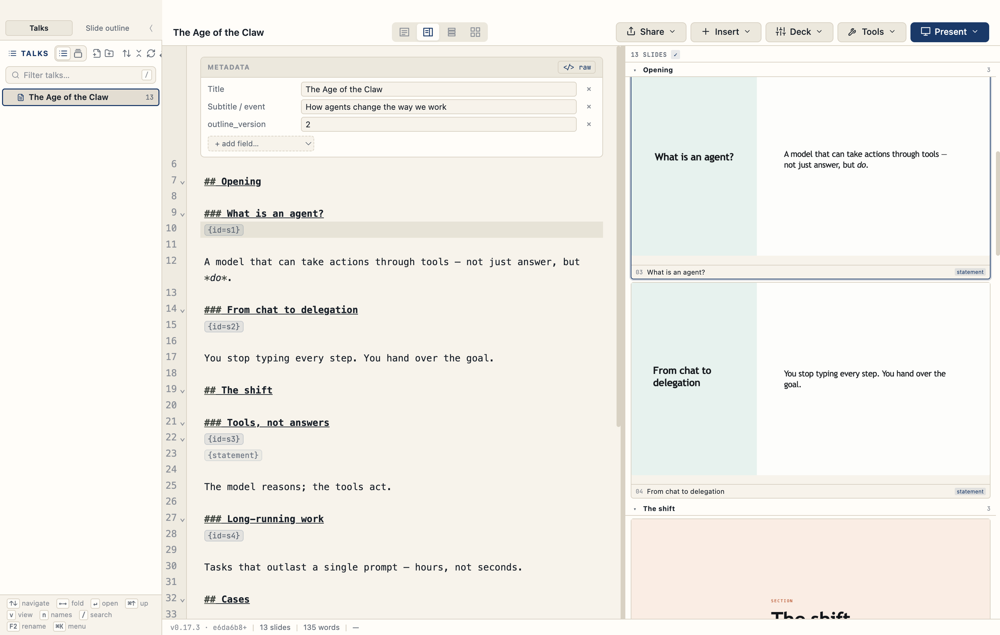

# TalkWeaver



A desktop app for **writing talks as plain-text outlines and presenting them as slides**. You
keep a folder ("vault") of Markdown outlines; TalkWeaver compiles each into a self-contained
HTML deck with a presenter view, and gives you a keyboard-first editor, a slide browser, and
tools for building alternate cuts of a talk without duplicating it.

It is a power-user tool built around one idea: **the outline is the source of truth, and
everything else is a view of it.**

> **Status:** early public release. It runs well on Apple Silicon macOS (where it is developed
> daily); the Windows build is provided best-effort and some macOS-only features are absent
> there (see [Platform support](#platform-support)).

## Features

- **Outline-first authoring** — every heading is a slide; write in Markdown, present in seconds.
- **Presenter view** — notes, a clock, and step-through, in a separate window from the audience.
- **Slide designs** — a registry of layouts (statements, two-column, image grids, container
  carousels, contents pages, and more), chosen with a keyboard picker or an inline `{ }` syntax.
- **Inspector** — pre-render any slide and tweak its options live (`⌘P`).
- **Pathways** — build a shorter or audience-specific cut of a talk by *ticking* slides; the
  outline never changes. View them as a Grid, a numbered List, or a cross-pathway Matrix.
- **Planned Runs & handouts** — schedule deliveries, attach recordings, and publish a per-Run
  handout, all from History.
- **Publishing and going live** — optional one-click publish of a handout to your own Cloudflare
  account, plus live polls, questions and Share for comments, all set up from Settings → Cloudflare
  (the screen explains each step), or by a coding agent with the `TalkWeaver setup` command.
- Full keyboard parity, a searchable command palette (`⌘⇧P`), and a `?` shortcut cheat-sheet.

## Install

### macOS (Apple Silicon)

1. Download [`TalkWeaver-mac-arm64.dmg`](https://github.com/techczech/talkweaver-app/releases/latest/download/TalkWeaver-mac-arm64.dmg)
   from the [latest release](https://github.com/techczech/talkweaver-app/releases/latest).
2. Open the DMG and drag TalkWeaver to Applications, then open it.

The build is signed with an Apple Developer ID and notarised by Apple, so it opens normally.

Try the beta: see [Releases](https://github.com/techczech/talkweaver-app/releases) for the newest pre-release. Beta features are new and not fully tested, so keep a copy of important talks.

### Windows

Download and run [`TalkWeaver-windows-x64-setup.exe`](https://github.com/techczech/talkweaver-app/releases/latest/download/TalkWeaver-windows-x64-setup.exe)
from the [latest release](https://github.com/techczech/talkweaver-app/releases/latest). The Windows
build is unsigned, so SmartScreen warns about an unrecognised publisher on first launch: choose
**More info → Run anyway**. A few macOS-only features (text recognition in images, some media
tools) are not available on Windows.

## First run

TalkWeaver asks you to pick a **vault** — any folder where your talks live. Each talk is a
sub-folder containing a `*-outline.md` file. Start a new talk from the app, or point it at a
folder you already have.

## Platform support

| Feature | macOS (Apple Silicon) | Windows |
| --- | --- | --- |
| Authoring, presenting, designs, Pathways, Runs | ✅ | ✅ |
| Cloudflare: publishing, going live, share-link domain, recording storage (set up in Settings → Cloudflare, or by an agent with `TalkWeaver setup`) | ✅ | ✅ tested automatically against a stand-in for Cloudflare; a real publish and go-live on a Windows computer is checked by hand, and was not run for 0.38.2 |
| Secrets (the Cloudflare token, recording keys, share keys) | ✅ macOS Keychain | ✅ Windows protected storage (DPAPI), tested automatically |
| Slide-image OCR search | ✅ | ✗ (macOS Vision only) |
| Video/media probing | ✅ | ✗ (macOS only) |
| Local transcription | ✅ the engine that ships needs Apple silicon; ffmpeg ships with the app | ⚠ ffmpeg ships and is tested, but the engine that ships cannot run; bring your own engine |

Going live is set up per computer. Intel Macs are not built yet.

## Build from source

Requires [Node.js](https://nodejs.org) 20+ and, for the macOS native helpers, the Swift
toolchain (Xcode command-line tools).

```sh
npm install
npm run dev            # run in development
npm test              # full test suite
npm run dist:mac:release   # build a macOS installer (.dmg + .zip) into release/
npm run dist:win:release   # build a Windows installer (.exe) — run on Windows
```

## Contributing

Issues and pull requests are welcome. The codebase favours small, test-anchored changes; run
`npm test` before opening a PR.

## Licence

[MIT](LICENSE) © 2026 Dominik Lukeš

The app also ships parts made by others under their own licences, among them FFmpeg (GNU GPL v3):
see [THIRD-PARTY-NOTICES.md](THIRD-PARTY-NOTICES.md).
