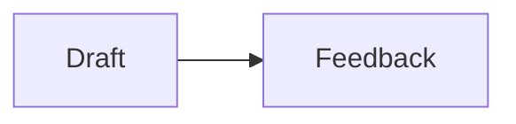

# TalkWeaver layout and object chooser

Use this before writing a custom HTML widget, an `[Embed:]` page or an image of a diagram. Most diagram, number and sequence shapes already exist as a one-word trigger. Triggers below are exactly as registered; do not translate them from English (`{sub}` is a subsection divider, `{process}` is also written `{agenda}`, `{steps}` is also `{stairs}`).

Where a trigger goes: on its own line directly under the `###` heading (or on the heading line), for example:

```markdown
### Slide title
{stats}

- 1 billion: weekly users
```

Terms used in the registry and here:

- Layout: sets the whole slide shape.
- Modifier: a flag added to a slide that already has a layout (`{reveal}`, `{iconlist}`, `{notitle}`).
- Container: set on a `##` section or a slide with child slides (`{contents}`, `{carousel}`).
- Component: an inline element inside a slide (code, QR, action button, embed, countdown).
- Object: a layout or component the registry marks as one structured, editable block with its own Insert-menu door. Registered objects: `table`, `chart` (with `barchart`, `piechart`, `linechart`), `mindmap`, `mermaid`, `svg`. The Insert menu also offers Chart and Diagram doors that open the layout picker. `{equation}` is a registered slide layout (Diagrams group), not a registered object.

For AI chat and terminal slides, also read `talkweaver-ai-chat-and-terminal-slides.md` in this folder.

## 1. Choose by what the content is

| The content is | Use | Notes |
|---|---|---|
| One sentence to remember | `{statement}` | Variants: `statement-bg=rule`, `statement-bg=strong`, `statement-bg=lower-third`, `statement-align=centred`. |
| One claim plus the points that support it | `{stmt-list}` | Claim paragraph, then bullets. |
| Someone else's exact words | `{quote}` | `form=tweet`, `form=video`, `form=book`, `form=paper`, `form=web` style it from the source link. |
| A quote with a picture of the person or source | `{image-quote}` | Image, `>` quotation, attribution bullet. |
| Two to four big numbers | `{stats}` | `- 1 billion: weekly users`. |
| Values to compare by size | `{barchart}` or `{chart}` | `label: number` bullets. `{novalues}` hides the numbers. |
| Shares of a whole adding to 100 | `{piechart}` | |
| A number changing over time | `{linechart}` (alias `{curve}`) | |
| Slow start, fast growth, levelling off | `{sigmoid}` | `label: number` bullets. |
| Points where order matters | `{numbered}` | Modifier on a list. |
| Three to six steps, shown as numbered stops | `{process}` (alias `{agenda}`) | |
| Steps joined by arrows, left to right | `{flow}` | `flow=vertical`, `flow=loop`, `flow=branch`. |
| Stages that rise, each a step up | `{steps}` (alias `{stairs}`) | |
| Events with dates | `{timeline}` | `timeline=rail`, `columns`, `compact`, `horizontal`, `spine`, `pills`, `dynamic`. |
| A short timeline with a comment | `{timeline-visual}` | Bullets with dates, then a paragraph. |
| A day's schedule with breaks | `{timetable}` | `- 09:00 - Welcome`. |
| Levels building on each other, foundation last | `{pyramid}` | Apex first, base last. |
| Stages that repeat | `{cycle}` | Also `{flow=loop}`. |
| Parts that combine into a result (A + B = C) | `{equation}` | `equation=pills`, `circle`, `square`, `oval`. Result last. |
| One central thing with the parts that feed it | `{system-map}` | Parent bullet, sub-bullets. |
| A hierarchy | `{orgchart}` | Parent bullet, sub-bullets; deeper indentation makes deeper levels. |
| One idea with branches | `{mindmap}` (object) | |
| Groups with sub-points as boxes joined by lines | `{smartart}` | |
| Named relationships between things | `{conceptmap}` | See the contradiction note in section 4. |
| Two sides against each other (before / after) | `{contrast}` | `contrast=cards`, `ledger`, `rows`, `tint`, `flip`. |
| Two equal options, title hidden | `{compare}` | Two `####` halves. |
| Two to four groups, each with its own points | `{columns}` | `####` headings. Long list in two or three columns: `{2col}`, `{3col}`. |
| Three to six short equal points | `{cards}` | `cards=grid`, `cards=rows`, `cards=stepped`. |
| Four to nine short items, no order | `{grid}` | `{grid}{blocks:2x2}`. |
| Rows and columns of shared attributes | `{table}` (object) | Nested list or Markdown pipe table. |
| Short points each with an icon | `{iconlist}` (alias `{icons}`) | Three to seven points. |
| Three to five items in a row with icon and note | `{iconrow}` (alias `{icon-row}`) | |
| Products or companies as logos | `{logolist}` (alias `{logos}`) | |
| Points that each carry a short note | `{annotated}` | Sub-bullet becomes a right-hand note. |
| One image, video or embed | `{media}` | |
| Short text beside one picture | `{copy-visual}` | |
| Image with two or three claims about it | `{image-claim}` | |
| List of features beside an image or video | `{list-visual}` | |
| Several images with captions | `{image-grid}` | `{image-steps}` steps through them. |
| Screenshots plus what to do next | `{cta-screenshots}` | |
| AI chat, hidden work as click-open rows | `{chat}` | ```` ```chat ```` fence. |
| AI chat with a "Behind the scenes" panel | `{chat-lanes}` | ```` ```chat ```` fence. |
| Shell commands and output | `{terminal}` | ```` ```terminal ```` fence. |
| An AI agent working in a terminal | `{terminal-agent}` | ```` ```terminal ```` fence. |
| Any turn-by-turn dialogue between named speakers | `{trace}` | ```` ```trace ```` fence, `Speaker: words` lines. |
| Code | `{code}` or a language fence | |
| Diagram written in Mermaid / hand-drawn SVG | ```` ```mermaid ````, ```` ```svg ```` | Both unverified in the registry. |
| Live page or simulation | `[Embed: url]` (also `[Simulation: file]`); bare URL auto-embeds | `{page-60}`, `{page-70}`, `{page-80}` set its width beside text. |
| QR code, action button | `[QR: url \| Label]`, `[Action: Label -> url]` | |
| Timed activity on screen | `{countdown-digits-90s}`, `{countdown-bar-3min}` | Pattern: `countdown-(digits\|bar)-<time>`. |
| Links for afterwards | `{links}` | |
| Several full slides stepped through on one slide | `{carousel}` | |
| A section shown as a grid of its slides | `{grid-linear}`, `{grid-zoom}` | On a `##` heading. |
| A section that opens with a contents list | `{contents}` (`contents=strip`) | On a `##` heading. |
| Show points one at a time | `{reveal}`; dim the rest: `{focus}`; one beat for a list: `{group}` | Modifiers. `{nostep}` opts a slide out. |
| Opening, divider, closing | `{title}`, `## heading`, `{sub}`, `{closing}` | |
| Audience poll | `{poll=single}`, `poll=multiple`, `open`, `ranking`, `rating`, `categorisation`, `board` | Poll options are global option groups, outside the layout registry list below. |

## 2. Catalogue

Order follows the picker groups: Everyday, Structure, Diagrams, Specialised, Modes. Each entry gives the registered trigger, option tokens the registry lists, what it renders, when it fits (registry `whenItFits`), the body shape (registry `authoring` text), and one example. Examples are the registry's own `sample` text, which is the same minimal form the layout sampler carries; for `trace` and `trace-dialogue` the sampler's fenced form is used because the registry sample contradicts it (section 4). "Library use" is from section 3.

Stated size limits exist only as the ranges in "Fits" (for example "three to seven"). Neither the registry nor the sampler states a hard maximum; the sampler tests quotations from about 100 to 900 characters. Treat the ranges as design guidance, and check the rendered slide.

Global options that apply to many layouts (`titlelook=`, `font-body=`, `font-title=`, `image=left|right`, `section=corner|off`, `claim=plain|bar`, `narrowcols=`, `screenshots=`, `shotlist=`, `reactions`, poll settings, pre-work settings) are registered in `GLOBAL_OPTION_GROUPS` in entries.ts and are not repeated per layout.

## Everyday entries

### `statement`  (slide layout; registry status: stable)

- Trigger: `{statement}`
- Option `statement-sidebar`: (none = default), `statement-sidebar=on`, `statement-sidebar=off`
- Option `statement-bg`: (none = default), `statement-bg=rule`, `statement-bg=strong`, `statement-bg=lower-third`
- Option `statement-align`: (none = default), `statement-align=centred`
- Option `statement-colour`: (none = default), `accent=cobalt`, `accent=emerald`, `accent=vermilion`, `accent=forest`
- Renders: Single bold claim beside the title.
- Fits: One sentence you want the room to remember.
- Body shape (registry): Write one paragraph below the trigger. Keep the heading as the slide title.
- Library use: 665 uses in 63 talks

````markdown
### One sentence that lands
{statement}

The registry is the product contract.
````

### `list`  (slide layout; registry status: stable)

- Trigger: `{list}`
- Option `list-style`: (none = default), `iconlist`, `logolist`, `numbered`, `annotated`
- Option `icon-level`: (none = default), `icons=top`, `icons=all`, `icons=off`
- Renders: Plain bullet list; the default content layout.
- Fits: Any set of points; the default when nothing else fits better.
- Body shape (registry): Write each point as a top-level bullet (- followed by a space). Indent sub-bullets under their parent.
- Library use: 120 uses in 23 talks

````markdown
### Plain list
{list}

- First point
- Second point
- Third point
````

### `iconlist`  (modifier (flag on a slide; no layout of its own); registry status: stable)

- Trigger: `{iconlist}`; also accepted: `icons`, `liststyle=icons`
- Option `iconlist-variant`: (none = default), `iconlist=boxes`, `iconlist=list`
- Renders: List styling flag: semantic icon bullets.
- Fits: Three to seven short points, each with an icon for what it is.
- Library use: 490 uses in 55 talks

````markdown
### Icon list
{iconlist}

- Speed {icon=lucide:zap}
- Judgement {icon=lucide:brain}
- Craft {icon=lucide:wrench}
````

### `numbered`  (modifier (flag on a slide; no layout of its own); registry status: stable)

- Trigger: `{numbered}`; also accepted: `liststyle=numbers`
- Option `number-style`: (none = default), `numbered=plain`, `numbered=styled`
- Renders: List styling flag: the icon-list layout with numbers in place of icons.
- Fits: Points whose order matters, or that you will refer to by number.
- Library use: 30 uses in 23 talks

````markdown
### Numbered list
{numbered}

- Plan
- Build
- Verify
````

### `quote`  (slide layout; registry status: stable)

- Trigger: `{quote}`
- Option `quote-form`: (none = default), `form=plain`, `form=tweet`, `form=video`, `form=book`, `form=paper`, `form=web`
- Renders: Full-bleed pull quote; no title by default. A source line that links to a post on X, a YouTube video, a paper or a book can show the quote in the source's own look.
- Fits: Someone else's words, quoted exactly, with who said them: a plain quote, or one styled as a tweet, a video, a book, a paper or a web page.
- Body shape (registry): Start each quotation line with >. Put the attribution in a bullet after a blank line.
- Library use: 84 uses in 30 talks

````markdown
### Quote
{quote}

> Capability is not the same as judgement.

- Source
````

### `annotated`  (modifier (flag on a slide; no layout of its own); registry status: stable)

- Trigger: `{annotated}`; also accepted: `sublist=aside`
- Renders: List modifier: nested children become right-hand annotations.
- Fits: Points that each carry a short note, written as a sub-point.
- Library use: 32 uses in 20 talks

````markdown
### Annotated list
{annotated}

- Registry
  - one source of truth
- Sampler
  - the contract
````

### `sidebar`  (modifier (flag on a slide; no layout of its own); registry status: stable)

- Trigger: `{sidebar}`; also accepted: `title=side`, `title=sidebar`
- Renders: Title placement modifier: title in a plain left rail.
- Fits: Any text slide whose title should sit in a band on the left.
- Library use: 577 uses in 47 talks

````markdown
### Sidebar title
{sidebar}

- The title sits in a left rail
- Content flows beside it
````

### `media`  (slide layout; registry status: stable)

- Trigger: `{media}`
- Renders: Full-bleed image, video or embed with title on top.
- Fits: One image, video or embed that carries the slide on its own.
- Body shape (registry): Write a Markdown image reference , a video reference or an embed on its own line.
- Library use: 454 uses in 41 talks

````markdown
### Image
{media}


````

### `contrast`  (slide layout; registry status: stable)

- Trigger: `{contrast}`
- Option `variant`: (none = default), `contrast=cards`, `contrast=ledger`, `contrast=rows`, `contrast=tint`, `contrast=flip`
- Renders: Two-column comparison; opt-in variants: ledger, rows, tint and flip.
- Fits: Two sides set against each other, such as before and after.
- Body shape (registry): Write exactly two top-level bullets: the first is the left side and the second is the right side. With no sub-bullets, Manual and Automated are the two sides. Indent sub-bullets under Before and After to supply each column. Do not use headings for the columns. Existing rows in which every bullet contains left / right remain supported; their slash separates the sides.
- Library use: 91 uses in 27 talks

````markdown
### Manual and automated
{contrast}

- Manual
- Automated

### Before and after
{contrast}

- Before
  - Manual work
  - Separate tools
- After
  - Automated work
  - One workspace
````

### `compare`  (slide layout; registry status: stable)

- Trigger: `{compare}`
- Renders: 50/50 comparison — two halves (tint vs paper), title hidden, second half reveals.
- Fits: Two options of equal weight side by side, with no title.
- Body shape (registry): Use two child groups, each with a label and its body, as shown below. Keep both groups under the comparison heading.
- Library use: 0 uses in 0 talks

````markdown
### What LLMs can and cannot do
{compare}

#### What LLMs can do for you

Be a **ramp** to higher learning.

#### What LLMs cannot do for you

The learning.
````

### `copy-visual`  (slide layout; registry status: stable)

- Trigger: `{copy-visual}`
- Renders: Text and a single visual side by side.
- Fits: A short text beside one picture that illustrates it.
- Body shape (registry): Write one visual reference and a text paragraph, separated by a blank line. The visual and copy share the slide.
- Library use: 100 uses in 20 talks

````markdown
### Copy and visual
{copy-visual}


Text sits beside a single visual.
````

### `cards`  (slide layout; registry status: stable)

- Trigger: `{cards}`
- Option `form`: (none = default), `cards=grid`, `cards=rows`, `cards=stepped`
- Option `cards-icons`: (none = default), `icons`
- Renders: Static grid of equal-weight cards; {cards=grid} pins #### groups to the grid, {cards=rows} lays them as full-width label rows (Label: value lines become label groups).
- Fits: Three to six short points of equal weight.
- Body shape (registry): Write one top-level bullet per card. Use the Cards options to change how the cards appear.
- Library use: 40 uses in 5 talks

````markdown
### Cards
{cards}

- Oracle
- Tool maker
- Tool user

### Cards as label rows {cards=rows}

#### AI as Oracle

- Capabilities: answer questions, summarise
- Chatbots: ChatGPT, Gemini, Claude

#### AI as Tool Maker

- Capabilities: write code, manage a code base
- Tools: Cursor, Lovable, Google AI Studio
````

### `carousel`  (container (set on a ## section or a slide that holds child slides); registry status: stable)

- Trigger: `{carousel}`
- Renders: Step through full sub-slides one at a time.
- Fits: Several full slides stepped through one at a time on one slide.
- Body shape (registry): Separate each thought with a blank line. Each block is a carousel item.
- Library use: 135 uses in 31 talks

````markdown
### Carousel
{carousel}

First thought.

Second thought.
````


## Structure entries

### `title`  (slide layout; registry status: stable)

- Trigger: `{title}`
- Renders: Opening title slide.
- Fits: The opening slide: talk title, event and author.
- Body shape (registry): Write the title in the heading and any subtitle as a paragraph below the trigger.
- Library use: 7 uses in 5 talks

````markdown
### Understanding agents
{title}

AI Workshop 2026
````

### `section`  (slide layout; registry status: stable)

- Trigger: `{role=section-title}`
- Renders: Divider between major parts of the talk.
- Fits: The start of a major part of the talk.
- Body shape (registry): Write a level-two heading (##), followed by its child slides. An empty parent body becomes a section divider.
- Library use: 0 uses in 0 talks

````markdown
## Section divider

### Child slide

- Content makes the parent a section.
````

### `subsection`  (slide layout; registry status: stable)

- Trigger: `{sub}`; also accepted: `sub`
- Renders: Divider under the current section.
- Fits: The start of a smaller part inside a section.
- Body shape (registry): Write {sub} under the subsection heading, then its child slides. Leave the divider body empty.
- Library use: 87 uses in 17 talks

````markdown
## Main section

### Subsection divider
{sub}

#### Child slide

- Content makes the parent a subsection.
````

### `closing`  (slide layout; registry status: stable)

- Trigger: `{closing}`
- Renders: Closing or thanks slide.
- Fits: The last slide: thanks, and where to find you and the handout.
- Body shape (registry): Write a closing message below the trigger. Separate a link or contact line with a blank line.
- Library use: 8 uses in 8 talks

````markdown
### Thank you
{closing}

**Thank you**

yoursite.example
````

### `timeline`  (slide layout; registry status: stable)

- Trigger: `{timeline}`; bare words: `timelinevertical`, `timelinehorizontal`, `timelinespine`, `timeline-pills`, `timelinepills`, `timelinedynamic`
- Option `timeline-mode`: (none = default), `timeline=rail`, `timeline=columns`, `timeline=compact`, `timeline=horizontal`, `timeline=spine`, `timeline=pills`, `timeline=dynamic`
- Renders: Dated chronology rail.
- Fits: Events in order, each starting with a year or a date.
- Body shape (registry): Write one top-level bullet per stop. Put its date or label on the parent and indent the stop details below it.
- Library use: 63 uses in 37 talks

````markdown
### Timeline
{timeline}

- 2022
  - Launch
- 2026
  - Agents
````

### `grid`  (slide layout; registry status: stable)

- Trigger: `{grid}`
- Renders: Tiled grid of blocks.
- Fits: Four to nine short items with no order, laid out as tiles.
- Body shape (registry): Write one bullet per tile. Set the grid dimensions with a token such as {blocks:2x2}.
- Library use: 22 uses in 19 talks

````markdown
### Grid
{grid}{blocks:2x2}

- One
- Two
- Three
- Four
````

### `system-map`  (slide layout; registry status: stable)

- Trigger: `{system-map}`
- Option `palette`: (none = default), `multicolour`
- Renders: Central node with satellites and connector rails.
- Fits: One central thing with the parts that feed into it.
- Body shape (registry): Write the system as a parent bullet and indent its parts as sub-bullets.
- Library use: 0 uses in 0 talks

````markdown
### System map
{system-map}

- TalkWeaver
  - Compiler
  - Editor
  - Runtime
````


## Diagrams entries

### `columns`  (slide layout; registry status: stable)

- Trigger: `{columns}`
- Renders: Top-level nodes in equal columns.
- Fits: Two to four groups, each a #### heading with its own points.
- Body shape (registry): Use child groups beneath the slide heading, one group per column, as shown in the example.
- Library use: 0 uses in 0 talks

````markdown
### Columns
{columns}

#### Left

- One
- Two

#### Right

- Three
- Four
````

### `2col`  (modifier (flag on a slide; no layout of its own); registry status: stable)

- Trigger: `{2col}`
- Renders: Column arity flag: two equal columns.
- Fits: A long list split into two equal columns.
- Library use: 56 uses in 26 talks

````markdown
### 2col
{2col}

#### Left

- One

#### Right

- Two
````

### `3col`  (modifier (flag on a slide; no layout of its own); registry status: stable)

- Trigger: `{3col}`
- Renders: Column arity flag: three equal columns.
- Fits: A long list of short items split into three columns.
- Library use: 0 uses in 0 talks

````markdown
### 3col
{3col}

#### One

- A

#### Two

- B

#### Three

- C
````

### `pyramid`  (slide layout; registry status: stable)

- Trigger: `{pyramid}`
- Renders: Stacked tiers: narrow apex, widest base.
- Fits: Levels that build on each other, with the foundation last.
- Body shape (registry): Write the tiers as top-level bullets, from apex to base. Indent details under the relevant tier.
- Library use: 11 uses in 5 talks

````markdown
### Pyramid
{pyramid}

- Apex
- Middle
- Base
````

### `orgchart`  (slide layout; registry status: stable)

- Trigger: `{orgchart}`
- Renders: Top node with a child tree from a nested list.
- Fits: A hierarchy: one item at the top with sub-points beneath it.
- Body shape (registry): Write the lead as a parent bullet and indent its reports beneath it. Further indentation creates deeper levels.
- Library use: 0 uses in 0 talks

````markdown
### Org chart
{orgchart}

- Lead
  - Team A
  - Team B
````

### `mindmap`  (slide layout - registered as an OBJECT; registry status: stable)

- Trigger: `{mindmap}`
- Renders: Central node with children radiating as branches.
- Fits: One idea with branches and sub-branches around it.
- Body shape (registry): Write the central topic as a parent bullet and indent its branches beneath it.
- Object: stored as `trigger-list`; edited as `outline`.
- Library use: 2 uses in 2 talks

````markdown
### Mind map
{mindmap}

- AI as oracle
  - Capabilities
  - Chatbots
````

### `mermaid`  (inline component/element - registered as an OBJECT; registry status: unverified)

- Trigger: ````mermaid`
- Renders: Fenced mermaid diagram, rendered client-side (vendored, strict security).
- Object: stored as `fence`; edited as `source`.
- UNVERIFIED in `layout-sampler-unverified-report.md`: compiled and rendered non-empty, but held for live verification.
- Library use: 0 uses in 0 talks; plus 4 fenced blocks in 1 talks

````markdown
### Mermaid diagram


````

### `svg`  (inline component/element - registered as an OBJECT; registry status: unverified)

- Trigger: ````svg`
- Renders: Fenced inline SVG, sanitised fail-closed at build time.
- Object: stored as `fence`; edited as `source`.
- UNVERIFIED in `layout-sampler-unverified-report.md`: compiled and rendered non-empty, but held for live verification.
- Library use: 0 uses in 0 talks; plus 14 fenced blocks in 10 talks

````markdown
### SVG illustration

```svg
<svg xmlns="http://www.w3.org/2000/svg" viewBox="0 0 320 180">
  <rect width="320" height="180" rx="12" fill="#f2f0ea"/>
</svg>
```
````

### `conceptmap`  (slide layout; registry status: stable)

- Trigger: `{conceptmap}`
- Renders: Node-edge graph from relation lines.
- Fits: Things joined by named links, written as A -> B: label.
- Body shape (registry): Write one relationship per bullet as source -relationship- target.
- Library use: 0 uses in 0 talks

````markdown
### Concept map
{conceptmap}

- Model -powers- Agent
- Agent -uses- Tools
````

### `stats`  (slide layout; registry status: stable)

- Trigger: `{stats}`
- Renders: Big-number row.
- Fits: Two to four big numbers, each written as number: what it counts.
- Body shape (registry): Write one bullet per statistic as value: description.
- Library use: 0 uses in 0 talks

````markdown
### Stats
{stats}

- 1 billion: weekly users
- 5 days: to one million users
````

### `process`  (slide layout; registry status: stable)

- Trigger: `{process}`; also accepted: `agenda`
- Renders: Numbered-circle agenda strip on a connector line.
- Fits: Three to six steps in order, shown as a strip of numbered stops.
- Body shape (registry): Write one top-level bullet per stage, in process order.
- Library use: 0 uses in 0 talks

````markdown
### Process strip
{process}

- Discover
- Design
- Build
````

### `steps`  (slide layout; registry status: stable)

- Trigger: `{steps}`; also accepted: `stairs`
- Renders: Ascending staircase.
- Fits: Stages that rise, each one a step up from the last.
- Body shape (registry): Write one top-level bullet per step, in order.
- Library use: 1 uses in 1 talks

````markdown
### Steps
{steps}

- Crawl
- Walk
- Run
````

### `iconrow`  (slide layout; registry status: stable)

- Trigger: `{iconrow}`; also accepted: `icon-row`
- Renders: Horizontal icon, label and description row.
- Fits: Three to five items in a row, each with an icon and a short note.
- Body shape (registry): Write one top-level bullet per item. Add {icon=lucide:name} to choose its icon; indent supporting text beneath the item.
- Library use: 231 uses in 48 talks

````markdown
### Icon row
{iconrow}

- Model {icon=lucide:brain}
  - outputs tokens
- Orchestration {icon=lucide:computer}
  - runs them
````

### `cycle`  (slide layout; registry status: stable)

- Trigger: `{cycle}`
- Renders: Circular arrow flow.
- Fits: Stages that repeat, the last leading back to the first.
- Body shape (registry): Write one top-level bullet per stage, in cycle order.
- Library use: 19 uses in 18 talks

````markdown
### Cycle
{cycle}

- Repetition
- Reflection
````

### `equation`  (slide layout; registry status: stable)

- Trigger: `{equation=pills}`; also accepted: `equation=circle`, `equation=square`, `equation=oval`
- Option `shape`: (none = default), `equation=pills`, `equation=circle`, `equation=square`, `equation=oval`
- Renders: Converging relationship: items combine into a result.
- Fits: Parts that combine into a result, with the result last.
- Body shape (registry): Write one top-level bullet per term. The trigger chooses the equation treatment.
- Library use: 24 uses in 13 talks

````markdown
### Equation
{equation=pills}

- Time
- Effort
- Learning
````


## Specialised entries

### `smartart`  (slide layout; registry status: stable)

- Trigger: `{smartart}`
- Renders: SmartArt-style node diagram from a nested list.
- Fits: Groups with sub-points, drawn as boxes joined by lines.
- Body shape (registry): Write a bullet hierarchy. Indentation defines the branches of the diagram.
- Library use: 170 uses in 34 talks

````markdown
### SmartArt
{smartart}

- Cognition
  - Judgement
- Tools
  - Retrieval
````

### `timeline-visual`  (slide layout; registry status: stable)

- Trigger: `{timeline-visual}`
- Renders: Timeline in one column, comment beside it. Auto-chosen for a timeline paired with a standalone paragraph or quote.
- Fits: A short timeline with a comment beside it.
- Body shape (registry): Write timeline stops as bullets, then a commentary paragraph separated by a blank line.
- Library use: 0 uses in 0 talks

````markdown
### Timeline beside a comment
{timeline-visual}

- 2024: First draft
- 2025: Registry
- 2026: The law

A timeline with a comment lays the two side by side.
````

### `list-visual`  (slide layout; registry status: stable)

- Trigger: `{list-visual}`
- Renders: Feature list in one column, media in the other. Auto-chosen for media plus a list with no prose.
- Fits: A list of features beside one image or video.
- Body shape (registry): Write the feature bullets and a visual reference in separate blocks, with a blank line between them.
- Library use: 0 uses in 0 talks

````markdown
### Feature list beside media
{list-visual}

- One
- Two
- Three


````

### `flow`  (slide layout; registry status: stable)

- Trigger: `{flow}`
- Option `direction`: (none = default), `flow=horizontal`, `flow=vertical`, `flow=loop`, `flow=branch`
- Renders: Left-to-right flow diagram from a list.
- Fits: Steps that lead from one to the next, left to right with arrows.
- Body shape (registry): Write one top-level bullet per node in order. Indent details under the node they belong to.
- Library use: 10 uses in 9 talks

````markdown
### Flow
{flow}

- Outline
- Compile
- Present
````

### `image-claim`  (slide layout; registry status: stable)

- Trigger: `{image-claim}`
- Renders: Image with a callout list of claims beside it.
- Fits: An image with two or three claims about it beside it.
- Body shape (registry): Write an image reference on its own line, then the claims as bullets after a blank line.
- Library use: 38 uses in 14 talks

````markdown
### Image and claim
{image-claim}


- The visual carries the moment
- Claims annotate it
````

### `cta-screenshots`  (slide layout; registry status: stable)

- Trigger: `{cta-screenshots}`
- Renders: Screenshot strip beside callouts and action items.
- Fits: Screenshots beside what to do next and the link to do it.
- Body shape (registry): Write the screenshot image reference, then the caption and an action token such as [Action: Get started -> https://example.com].
- Library use: 2 uses in 2 talks

````markdown
### CTA screenshots
{cta-screenshots}


- Try it today
- [Action: Get started -> https://example.com]
````

### `trace`  (slide layout; registry status: stable)

- Trigger: `{trace}`
- Renders: Role-tagged transcript of a turn-taking exchange.
- Fits: A conversation with an AI, turn by turn, as a transcript.
- Body shape (registry): Write speaker-labelled turns as bullets, using a colon between each speaker and message.
- Library use: 7 uses in 5 talks; plus 83 fenced blocks in 25 talks

````markdown
### Trace (transcript)
{trace}

```trace
User: Reorganise my Downloads folder by project.
Agent: I found 1,482 files. Grouping by the six project names in your notes. Shall I move screenshots into their matching projects too?
User: Yes, and delete the duplicates.
Agent: Done. 212 duplicates removed, structure written to a manifest you can undo.
```
````

### `trace-dialogue`  (slide layout; registry status: stable)

- Trigger: `{trace}`
- Renders: Any speaker-labelled dialogue rendered as a trace.
- Fits: Any conversation between named speakers, line by line.
- Body shape (registry): Write one speaker-labelled turn per line, with a colon between the speaker and message.
- Library use: Same token as `trace`; counted there.

````markdown
### trace-dialogue
{trace}

```trace
Student: Can I just use the chatbot to write the essay?
Tutor: You can. It will cost you exactly the learning the essay was for.
```
````

### `chat`  (slide layout; registry status: stable)

- Trigger: `{chat}`
- Option `sim-sidebar`: (none = default), `sidebar=off`
- Option `sim-open`: (none = default), `open=all`
- Option `sim-reveal`: (none = default), `reveal=steps`
- Option `sim-stream`: (none = default), `stream=on`
- Option `sim-size`: (none = default), `size=large`
- Renders: A chat window; reasoning, sources and tool calls are rows you click open.
- Fits: An AI conversation with the hidden work shown as rows between question and answer.
- Body shape (registry): Enclose the conversation in a fenced chat block: three backticks followed by chat, then the turns, then three closing backticks. Supported labels are user:, bot:, model-reasoning:, context-retrieval:, tool-call: and tool-results:. A reasoning label may include a duration such as (4s).  Message bodies render literal text: Markdown emphasis, links and bullets inside a message are not formatted. AI chat shows hidden work as disclosure rows; choose AI chat with behind the scenes to put that work in a separate panel. In the Inspector, open Layout for History sidebar, Text size, Reveal, Streaming and Disclosures.
- Library use: 14 uses in 8 talks; plus 41 fenced blocks in 11 talks

````markdown
### Refund policy
{chat}

```chat
user: What changed in our refund policy last month?
model-reasoning (4s): They want last month’s changes.
context-retrieval:
  Refund Policy v4.2
tool-call: search_policy_docs {"topic": "refunds"}
tool-results:
  Refund window cut from 30 to 14 days
bot: The refund window shrank from 30 to 14 days.
```
````

### `chat-lanes`  (slide layout; registry status: stable)

- Trigger: `{chat-lanes}`
- Option `sim-sidebar`: (none = default), `sidebar=off`
- Option `sim-open`: (none = default), `open=all`
- Option `sim-reveal`: (none = default), `reveal=steps`
- Option `sim-stream`: (none = default), `stream=on`
- Option `sim-size`: (none = default), `size=large`
- Renders: A chat window beside a Behind the scenes panel of reasoning, context and tool cards.
- Fits: An AI conversation where the audience should see the work beside the answer.
- Body shape (registry): Use a fenced chat block with user:, bot:, model-reasoning:, context-retrieval:, tool-call: and tool-results: labels. Indent continuation lines under their turn. Close the block with three backticks.  Message bodies render literal text rather than inline Markdown. This layout places hidden work beside the conversation; AI chat shows it as disclosure rows. In the Inspector, open Layout for History sidebar, Text size, Reveal, Streaming and Disclosures.
- Library use: 27 uses in 7 talks

````markdown
### Refund policy
{chat-lanes}

```chat
user: What changed in our refund policy last month?
model-reasoning (4s): They want last month’s changes.
tool-call: search_policy_docs {"topic": "refunds"}
tool-results:
  Refund window cut from 30 to 14 days
bot: The refund window shrank from 30 to 14 days.
```
````

### `terminal`  (slide layout; registry status: stable)

- Trigger: `{terminal}`
- Option `sim-reveal`: (none = default), `reveal=steps`
- Option `sim-size`: (none = default), `size=large`
- Renders: A plain shell window with typed commands and their output.
- Fits: Commands and their output, as they would look in a terminal.
- Body shape (registry): Enclose shell text in a fenced terminal block and close it with three backticks. Start commands with $; following lines are their output.
- Library use: 17 uses in 7 talks; plus 25 fenced blocks in 7 talks

````markdown
### A shell session
{terminal}

```terminal
~/policy $ ls
change-log.md  refund-policy.md
$ git log --oneline -1
a41c9e2 Cut refund window to 14 days
```
````

### `terminal-agent`  (slide layout; registry status: stable)

- Trigger: `{terminal-agent}`
- Option `sim-open`: (none = default), `open=all`
- Option `sim-reveal`: (none = default), `reveal=steps`
- Option `sim-size`: (none = default), `size=large`
- Renders: A coding-agent command line: prompt, thinking, tool calls and an answer.
- Fits: An AI agent doing work in a terminal, one tool block at a time.
- Body shape (registry): Enclose labelled turns in a fenced terminal block. Use user:, bot:, model-reasoning:, context-retrieval:, tool-call: and tool-results:. Close the block with three backticks.
- Library use: 8 uses in 7 talks

````markdown
### An agent at work
{terminal-agent}

```terminal
user: What changed in our refund policy last month?
model-reasoning (4s): check the change log first
tool-call: search_policy_docs {"topic": "refunds"}
tool-results:
  Refund window cut from 30 to 14 days
  Digital goods: refundable only if unused
bot: The refund window shrank from 30 to 14 days.
```
````

### `code`  (inline component/element; registry status: stable)

- Trigger: `{code}`
- Renders: Build-time syntax-highlighted code panel.
- Library use: 8 uses in 6 talks

````markdown
### Code
{code}

```python
def greet():
    return "hello"
```
````

### `table`  (slide layout - registered as an OBJECT; registry status: stable)

- Trigger: `{table}`
- Option `media-placement`: (none = default), `image=left`, `image=right`
- Option `table-header`: (none = default), `table-header=off`
- Option `table-columns`: (none = default), `table-columns=off`
- Option `table-first-column`: (none = default), `table-first-column=off`
- Renders: Nested list rendered as a table.
- Fits: Items that share the same attributes, compared in rows and columns.
- Body shape (registry): Write each column as a parent bullet and its cells as indented sub-bullets, in row order. A Markdown pipe table is also supported.
- Object: stored as `trigger-list`; edited as `grid`.
- Library use: 33 uses in 13 talks

````markdown
### Table
{table}

- Role
  - Oracle
  - Tool user
- Where
  - ChatGPT
  - Codex
````

### `qr`  (inline component/element; registry status: stable)

- Trigger: `[QR: https://example.com | Label]`
- Renders: Build-time QR code element.
- Library use: 5 uses in 5 talks

````markdown
### QR code

[QR: https://example.com | Label]
````

### `action`  (inline component/element; registry status: stable)

- Trigger: `[Action: Label -> https://example.com]`
- Renders: Accent action button element.
- Library use: 0 uses in 0 talks

````markdown
### Action button

[Action: Label -> https://example.com]
````

### `embed`  (inline component/element; registry status: stable)

- Trigger: `[Embed: https://example.com]`
- Renders: Embedded iframe or live simulation element.
- Library use: 25 uses in 14 talks

````markdown
### Embed

[Embed: https://example.com]
````

### `auto-embed`  (inline component/element; registry status: stable)

- Trigger: `https://example.com`
- Renders: A bare URL on its own line auto-embeds.
- Library use: 16 uses in 10 talks

````markdown
### Auto-embed

https://example.com
````

### `logolist`  (modifier (flag on a slide; no layout of its own); registry status: stable)

- Trigger: `{logolist}`; also accepted: `logos`, `liststyle=logos`
- Renders: List styling flag: brand logos only.
- Fits: Products or companies, shown by their logos.
- Library use: 54 uses in 35 talks

````markdown
### Logo list
{logolist}

- OpenAI
- Anthropic
- Google
````

### `image-quote`  (slide layout; registry status: stable)

- Trigger: `{image-quote}`; also accepted: `imagequote`
- Renders: Quote beside an image with an accent attribution bar.
- Fits: A quotation beside a picture of the person or the source.
- Body shape (registry): Write an image reference, a quotation starting with >, and an attribution bullet as separate blocks.
- Library use: 20 uses in 11 talks

````markdown
### Image quote
{image-quote}


> Practical tools for daily use.

- Source
````

### `image-grid`  (slide layout; registry status: stable)

- Trigger: `{image-grid}`; also accepted: `imagegrid`
- Renders: Figure cells with a caption under each.
- Fits: Several images, each with a caption beneath it.
- Body shape (registry): Write each image as a Markdown image reference in its own block, separated by a blank line.
- Library use: 47 uses in 27 talks

````markdown
### Image grid
{image-grid}


````

### `chart`  (slide layout - registered as an OBJECT; registry status: stable)

- Trigger: `{chart}`
- Option `values`: (none = default), `novalues`
- Option `chart-shape`: (none = default), `chart=bar`, `chart=pie`, `chart=line`
- Renders: Generic chart container; bar chart by default.
- Fits: Values to compare; a bar chart unless you choose another kind.
- Body shape (registry): Write one bullet per value as label: number. Choose the chart type in the layout options.
- Object: stored as `fence` (older `trigger-list` form still read); edited as `outline`.
- Library use: 2 uses in 1 talks

````markdown
### Chart
{chart}

- Alpha: 40
- Beta: 25
- Gamma: 35
````

### `barchart`  (slide layout - registered as an OBJECT; registry status: stable)

- Trigger: `{barchart}`
- Renders: Bar chart from a value list.
- Fits: A few values compared by size, written as label: number.
- Body shape (registry): Write one bullet per bar as label: number.
- Object: stored as `fence` (older `trigger-list` form still read); edited as `outline`.
- Library use: 5 uses in 5 talks

````markdown
### Bar chart
{barchart}

- Alpha: 40
- Beta: 25
- Gamma: 35
````

### `piechart`  (slide layout - registered as an OBJECT; registry status: stable)

- Trigger: `{piechart}`
- Renders: Pie chart from a value list.
- Fits: Shares of a whole that add up to a hundred.
- Body shape (registry): Write one bullet per slice as label: number.
- Object: stored as `fence` (older `trigger-list` form still read); edited as `outline`.
- Library use: 2 uses in 1 talks

````markdown
### Pie chart
{piechart}

- Alpha: 40
- Beta: 25
- Gamma: 35
````

### `linechart`  (slide layout - registered as an OBJECT; registry status: stable)

- Trigger: `{linechart}`; also accepted: `curve`
- Renders: Line chart from a value list.
- Fits: Values that change over time.
- Body shape (registry): Write the points in order as bullets containing label: number.
- Object: stored as `fence` (older `trigger-list` form still read); edited as `outline`.
- Library use: 4 uses in 4 talks

````markdown
### Line chart
{linechart}

- 2022: 1
- 2024: 50
- 2026: 100
````

### `sigmoid`  (slide layout; registry status: stable)

- Trigger: `{sigmoid}`
- Renders: Conceptual S-curve from staged items.
- Fits: Growth that starts slowly, speeds up and then levels off.
- Body shape (registry): Write the stages as bullets containing label: number.
- Library use: 0 uses in 0 talks

````markdown
### S-curve
{sigmoid}

- Early: 10
- Growth: 50
- Mature: 90
````

### `timetable`  (slide layout; registry status: stable)

- Trigger: `{timetable}`
- Renders: Day schedule rows with distinct break styling.
- Fits: A day's schedule, with times and breaks.
- Body shape (registry): Write one bullet per entry with its time, a hyphen and its description.
- Library use: 0 uses in 0 talks

````markdown
### Timetable
{timetable}

- 09:00 - Welcome
- 10:30 - Break
- 11:00 - Workshop
````

### `table-outline`  (slide layout; registry status: stable)

- Trigger: `{table}`
- Renders: Depth-0 list items become column headers.
- Fits: A table where each top-level point becomes a column.
- Body shape (registry): Write each column heading as a parent bullet, then indent its cells in row order.
- Library use: Same token as `table`; counted there.

````markdown
### table-outline
{table}

- Column A
  - One
  - Two
- Column B
  - Three
  - Four
````

### `plainlist`  (modifier (flag on a slide; no layout of its own); registry status: stable)

- Trigger: `{plainlist}`; also accepted: `liststyle=plain`
- Renders: List styling flag: force a plain list.
- Fits: A list that should stay plain when the deck adds icons elsewhere.
- Library use: 0 uses in 0 talks

````markdown
### plainlist
{plainlist}

- Plain item
- Another plain item
````

### `stmt-list`  (slide layout; registry status: stable)

- Trigger: `{stmt-list}`; also accepted: `stmtlist`
- Renders: Statement column beside a list column.
- Fits: One claim beside the points that support it.
- Body shape (registry): Write the claim as a paragraph, then the points as bullets after a blank line.
- Library use: 0 uses in 0 talks

````markdown
### stmt-list
{stmt-list}

The claim sits beside the list.

- First point
- Second point
````

### `links`  (slide layout; registry status: stable)

- Trigger: `{links}`
- Renders: Manual links index slide.
- Fits: A slide of links for people to follow up afterwards.
- Body shape (registry): Write Markdown links as [label](https://example.com), with separate links in separate blocks.
- Library use: 0 uses in 0 talks

````markdown
### links
{links}

[Example](https://example.com)
````


## Modes entries

### `reveal`  (modifier (flag on a slide; no layout of its own); registry status: stable)

- Trigger: `{reveal}`; also accepted: `mode=reveal`
- Renders: Step mode: reveal content one beat at a time.
- Fits: Points you want to show one at a time as you speak.
- Library use: 15 uses in 12 talks

````markdown
### Reveal mode
{reveal}

- Beat one
- Beat two
- Beat three
````

### `group`  (modifier (flag on a slide; no layout of its own); registry status: stable)

- Trigger: `{group}`
- Renders: Reveal a list as one beat instead of one bullet.
- Fits: A list that should appear all at once on a revealed slide.
- Library use: 0 uses in 0 talks

````markdown
### Group reveal
{group}{reveal}

- These arrive
- as one beat
````

### `focus`  (modifier (flag on a slide; no layout of its own); registry status: stable)

- Trigger: `{focus}`; also accepted: `mode=focus`
- Renders: Step mode: focus each beat, dimming the rest.
- Fits: Points you talk through in turn, the others dimmed but visible.
- Library use: 38 uses in 11 talks

````markdown
### Focus mode
{focus}

- Focus this
- Then this
- Then this
````

### `trigger-line`  (modifier (flag on a slide; no layout of its own); registry status: stable)

- Trigger: `{contrast}`
- Not a separate layout: it is the bare-trigger-line way of writing `{contrast}`.
- Renders: Put a trigger on the line under a heading.
- Fits: Two sides set against each other; gives the same slide as Contrast.
- Library use: Same token as `contrast`; counted there.

````markdown
### trigger-line
{contrast}

- Heading stays clean
- Trigger sits on its own line
````

### `countdown`  (inline component/element; registry status: stable)

- Trigger: `{countdown-digits-90s}`; also accepted: `countdown-bar-3min`
- Pattern forms: `^countdown-(digits|bar)-(.+)$`
- Renders: Per-slide countdown element.
- Library use: 0 uses in 0 talks

````markdown
### Countdown element
{countdown-digits-90s}

Discuss with your neighbour.
````

### `notitle`  (modifier (flag on a slide; no layout of its own); registry status: stable)

- Trigger: `{notitle}`; also accepted: `title=off`, `title=none`, `title=hide`
- Renders: Hide the on-slide title while keeping navigation text.
- Fits: A slide that speaks for itself; the title stays for navigation only.
- Library use: 183 uses in 30 talks

````markdown
### notitle
{notitle}

The visible heading is suppressed.
````

### `titletop`  (modifier (flag on a slide; no layout of its own); registry status: stable)

- Trigger: `{titletop}`; also accepted: `title=top`
- Renders: Force the top-title treatment.
- Fits: A slide whose title should run across the top, not in a side band.
- Library use: 30 uses in 17 talks

````markdown
### titletop
{titletop}

- Force the title rail to the top
- Keep the layout otherwise intact
````

### `accent`  (modifier (flag on a slide; no layout of its own); registry status: stable)

- Trigger: `{accent=vermilion}`
- Option `accent`: (none = default), `accent=cobalt`, `accent=emerald`, `accent=vermilion`, `accent=forest`
- Renders: Pin this section to a named colour from the deck palette.
- Fits: A section that should keep one colour from the deck palette.
- Library use: 29 uses in 6 talks

````markdown
## accent — pinned section colour
{accent=vermilion}

### Every child keeps the pin

- Named colour, never a hex value
````

### `nostep`  (modifier (flag on a slide; no layout of its own); registry status: stable)

- Trigger: `{nostep}`
- Renders: Disable stepping on this slide.
- Fits: A slide that should show everything at once in a stepped section.
- Library use: 0 uses in 0 talks

````markdown
### nostep
{nostep}{reveal}

- Everything stays visible
- Even when reveal mode is active
````

### `image-steps`  (modifier (flag on a slide; no layout of its own); registry status: stable)

- Trigger: `{image-steps}`; bare words: `no-image-steps`
- Renders: Next shows each image enlarged in turn, then the whole slide again.
- Fits: A slide of several images you want to talk through one at a time.
- Library use: 1 uses in 1 talks

````markdown
### Step through images
{image-steps}


````

### `emphasis-steps`  (modifier (flag on a slide; no layout of its own); registry status: stable)

- Trigger: `{emphasis-steps}`
- Renders: Bold, underline, strikethrough and highlight each appear on a press of Next, in reading order.
- Fits: A slide where you want to draw the eye to one phrase at a time as you speak.
- Library use: 0 uses in 0 talks

````markdown
### Emphasis appears on Next
{emphasis-steps}

- The first point has a **key phrase**
- The second has a ==highlighted claim==
- The third is ++underlined++, and one word is ~~struck~~
````

### `prework`  (modifier (flag on a slide; no layout of its own); registry status: stable)

- Trigger: `{prework}`
- Renders: Section: the pre-work form participants answer before the session; its slides are the steps and are not presented.
- Library use: 0 uses in 0 talks

````markdown
## Before the session
{prework}

Three short steps before Monday.

### Read this first

- One idea per slide
````

### `task`  (modifier (flag on a slide; no layout of its own); registry status: stable)

- Trigger: `{task}`
- Renders: Pre-work step: a task participants do before the session and mark as done (its list is the instructions).
- Library use: 0 uses in 0 talks

````markdown
## Before the session
{prework}

### Task 1: draft one real email
{task}

- Pick an email you need to send this week
- Ask Copilot to draft it
````

### `readonly`  (modifier (flag on a slide; no layout of its own); registry status: stable)

- Trigger: `{readonly}`
- Renders: Pre-task: participants read it; there is nothing to mark as done.
- Library use: 0 uses in 0 talks

````markdown
## Before the session
{prework}

### Task 2: bring one file
{task}{readonly}

- Choose a document with no personal data in it
````

### `check`  (modifier (flag on a slide; no layout of its own); registry status: stable)

- Trigger: `{check}`
- Renders: Pre-work step: a single-choice quick check; the right option ends with {right}; participants get no marks.
- Library use: 0 uses in 0 talks

````markdown
## Before the session
{prework}

### Quick check: what makes something an agent?
{poll=single}{check}

- It answers in full sentences
- It uses tools to carry out steps for you {right}
- Not sure yet
````

### `right`  (modifier (flag on a slide; no layout of its own); registry status: stable)

- Trigger: `{right}`
- Renders: Quick check list item: marks the right option (only you see it).
- Library use: 0 uses in 0 talks

````markdown
## Before the session
{prework}

### Quick check: which one acts?
{poll=single}{check}

- A chat
- An agent {right}
````

### `noask`  (modifier (flag on a slide; no layout of its own); registry status: stable)

- Trigger: `{noask}`
- Renders: Pre-work step: participants cannot ask about this step.
- Library use: 0 uses in 0 talks

````markdown
## Before the session
{prework}

### Welcome
{noask}

- Read two short slides
````

### `local`  (modifier (flag on a slide; no layout of its own); registry status: stable)

- Trigger: `{local}`
- Renders: Work-file step: the answer stays on the participant's phone and is never sent.
- Library use: 0 uses in 0 talks

````markdown
### Try one prompt on a paper of your own
{task}{minutes=20}{local}

1. Pick a paper you know well
````

### `names`  (modifier (flag on a slide; no layout of its own); registry status: stable)

- Trigger: `{names}`
- Renders: Board slides: participants may add an optional name to a card (only the presenter sees it).
- Library use: 0 uses in 0 talks

````markdown
### What should we keep, change, try?
{poll=board}{names}

- Keep
- Change
- Try
````

### `novalues`  (modifier (flag on a slide; no layout of its own); registry status: stable)

- Trigger: `{novalues}`; also accepted: `nonumbers`
- Renders: Hide chart value labels — bars keep only their relative shape.
- Fits: A chart where the shape matters and the exact numbers do not.
- Library use: 0 uses in 0 talks

````markdown
### novalues — shape-only comparison
{barchart}{novalues}

- Organising your life: 15
- Finding resources: 20
- Learning subject: 40
````

### `sidebar-40`  (modifier (flag on a slide; no layout of its own); registry status: stable)

- Trigger: `{sidebar-40}`; also accepted: `{sidebar-30}`, `{sidebar-35}`, `{sidebar-50}`
- Pattern forms: `^sidebar-(30|35|40|50)$`
- Renders: Pin the title-sidebar rail width (30/35/40/50%).
- Fits: A title band wider or narrower than the layout gives by default.
- Library use: 4 uses in 4 talks

````markdown
### sidebar-40 — pinned rail width
{sidebar-40}

- Wide rail shortens the text measure
- 30 and 35 and 50 are the other stops
````

### `page-70`  (modifier (flag on a slide; no layout of its own); registry status: stable)

- Trigger: `{page-80}`; also accepted: `{page-60}`, `{page-70}`
- Pattern forms: `^page-(60|70|80)$`
- Renders: Pin the share of the slide width an embedded page takes beside text (60/70/80%).
- Fits: A slide with a live page and a few words, where the page needs more or less room.
- Library use: 0 uses in 0 talks

````markdown
### page-80 — wide embedded page
{page-80}

- Text beside the page stays short

[Embed: page.html]
````

### `font-body`  (modifier (flag on a slide; no layout of its own); registry status: stable)

- Trigger: `{font-body=l}`; also accepted: `{font-title=xl}`
- Renders: Per-slide body/title size: xs s m l xl.
- Fits: A slide whose text should be a size larger or smaller than the rest.
- Library use: 89 uses in 28 talks

````markdown
### font-body — per-slide type override
{font-body=l}{font-title=s}

- Body steps up one size
- The title steps down one
````

### `grid-linear`  (container (set on a ## section or a slide that holds child slides); registry status: stable)

- Trigger: `{grid-linear}`
- Renders: Section container mode: grid, stepped in order.
- Fits: A section shown as a grid of its slides, then each in order.
- Body shape (registry): Put the container trigger under a level-two section heading. Its child slides supply the grid items.
- Library use: 3 uses in 3 talks

````markdown
## grid-linear
{grid-linear}

### First child

- One

### Second child

- Two
````

### `grid-zoom`  (container (set on a ## section or a slide that holds child slides); registry status: stable)

- Trigger: `{grid-zoom}`
- Renders: Section container mode: grid, zoom into each child.
- Fits: A section shown as a grid of its slides, zooming into each one.
- Body shape (registry): Put the container trigger under a level-two section heading. Its child slides supply the zoomable grid items.
- Library use: 4 uses in 4 talks

````markdown
## grid-zoom
{grid-zoom}

### First child

- One

### Second child

- Two
````

### `contents`  (container (set on a ## section or a slide that holds child slides); registry status: stable)

- Trigger: `{contents}`
- Option `variant`: (none = default), `contents=strip`
- Renders: Section container mode: agenda rail; {contents=strip} = filmstrip footer variant (ADR-0007).
- Fits: A section that opens with a list of what is in it.
- Body shape (registry): Put {contents} under the section heading. Its child headings supply the contents entries.
- Library use: 3 uses in 3 talks

````markdown
## contents
{contents}

### First child

- One

### Second child

- Two

## contents strip {contents=strip}

### Third child

- Three

### Fourth child

- Four
````

### `timer-audience`  (container (set on a ## section or a slide that holds child slides); registry status: unverified)

- Trigger: `{timer-audience}`
- Renders: Show a section timer to the audience.
- Fits: A timed section where the audience sees the clock too.
- Body shape (registry): Put {timer=10min}{timer-audience} under the section heading and the timed slides beneath it.
- UNVERIFIED in `layout-sampler-unverified-report.md`: compiled and rendered non-empty, but held for live verification.
- Library use: 0 uses in 0 talks

````markdown
## timer-audience
{timer=10min}{timer-audience}

### Timed child

- The section timer is visible to the room.
````

### `multicolour`  (modifier (flag on a slide; no layout of its own); registry status: stable)

- Trigger: `{multicolour}`; also accepted: `multicolor`
- Renders: Opt-in varied palette for supported diagram nodes.
- Fits: A diagram whose boxes should each have their own colour.
- Library use: 0 uses in 0 talks

````markdown
### multicolour
{system-map}{multicolour}{centre=TalkWeaver}

- Compiler
- Editor
- Runtime
- Presenter
````

## 3. Usage in the library

Method: every `*-outline.md` under the presentation library except `z-old-powerpoint-imports`, `z-sample-presentations` and `talkweaver-demos` (85 files, 2026-11-10). Brace tokens were read from heading lines and from lines made only of brace tokens, outside code fences and `:::notes` blocks; space-separated tokens in one brace group count separately. "Uses" counts trigger lines (roughly slides) carrying at least one token of the entry, so a slide with `{statement}` and `{statement-bg=rule}` counts once; "Talks" counts distinct outline files. Aliases, bare-word forms and `layout=<name>` are counted under their entry; option variants (`statement-bg=rule`, `timeline=spine`) are counted under their entry. `font-body` includes `font-title=`.

What the counts miss: slides whose layout is chosen automatically with no trigger (a plain list, a `>` quote, a Markdown pipe table, a `##` section divider, media plus list, timeline plus paragraph) are not counted. So `section` (zero) is certainly used; `table` and `quote` are under-counted. `{trace}`, `{chat}` and `{terminal}` also appear as fences, shown in the last column. `[Simulation:` appears 91 times in 11 talks; it is counted nowhere above (it is a form of the embed element). Entries that share a token with another entry (`table-outline` with `table`, `trace-dialogue` with `trace`, `trigger-line` with `contrast`) are counted once, under the first.

| Entry | Kind | Uses | Talks | Fenced blocks (talks) |
|---|---|---:|---:|---|
| `statement` | layout | 665 | 63 |  |
| `sidebar` | modifier | 577 | 47 |  |
| `iconlist` | modifier | 490 | 55 |  |
| `media` | layout | 454 | 41 |  |
| `iconrow` | layout | 231 | 48 |  |
| `notitle` | modifier | 183 | 30 |  |
| `smartart` | layout | 170 | 34 |  |
| `carousel` | container | 135 | 31 |  |
| `list` | layout | 120 | 23 |  |
| `copy-visual` | layout | 100 | 20 |  |
| `contrast` | layout | 91 | 27 |  |
| `font-body` | modifier | 89 | 28 |  |
| `subsection` | layout | 87 | 17 |  |
| `quote` | layout | 84 | 30 |  |
| `timeline` | layout | 63 | 37 |  |
| `2col` | modifier | 56 | 26 |  |
| `logolist` | modifier | 54 | 35 |  |
| `image-grid` | layout | 47 | 27 |  |
| `cards` | layout | 40 | 5 |  |
| `focus` | modifier | 38 | 11 |  |
| `image-claim` | layout | 38 | 14 |  |
| `table` | layout | 33 | 13 |  |
| `annotated` | modifier | 32 | 20 |  |
| `numbered` | modifier | 30 | 23 |  |
| `titletop` | modifier | 30 | 17 |  |
| `accent` | modifier | 29 | 6 |  |
| `chat-lanes` | layout | 27 | 7 |  |
| `embed` | component | 25 | 14 |  |
| `equation` | layout | 24 | 13 |  |
| `grid` | layout | 22 | 19 |  |
| `image-quote` | layout | 20 | 11 |  |
| `cycle` | layout | 19 | 18 |  |
| `terminal` | layout | 17 | 7 | 25 (7) |
| `auto-embed` | component | 16 | 10 |  |
| `reveal` | modifier | 15 | 12 |  |
| `chat` | layout | 14 | 8 | 41 (11) |
| `pyramid` | layout | 11 | 5 |  |
| `flow` | layout | 10 | 9 |  |
| `closing` | layout | 8 | 8 |  |
| `code` | component | 8 | 6 |  |
| `terminal-agent` | layout | 8 | 7 |  |
| `title` | layout | 7 | 5 |  |
| `trace` | layout | 7 | 5 | 83 (25) |
| `barchart` | layout | 5 | 5 |  |
| `qr` | component | 5 | 5 |  |
| `grid-zoom` | container | 4 | 4 |  |
| `linechart` | layout | 4 | 4 |  |
| `sidebar-40` | modifier | 4 | 4 |  |
| `contents` | container | 3 | 3 |  |
| `grid-linear` | container | 3 | 3 |  |
| `chart` | layout | 2 | 1 |  |
| `cta-screenshots` | layout | 2 | 2 |  |
| `mindmap` | layout | 2 | 2 |  |
| `piechart` | layout | 2 | 1 |  |
| `image-steps` | modifier | 1 | 1 |  |
| `steps` | layout | 1 | 1 |  |
| `3col` | modifier | 0 | 0 |  |
| `action` | component | 0 | 0 |  |
| `check` | modifier | 0 | 0 |  |
| `columns` | layout | 0 | 0 |  |
| `compare` | layout | 0 | 0 |  |
| `conceptmap` | layout | 0 | 0 |  |
| `countdown` | component | 0 | 0 |  |
| `emphasis-steps` | modifier | 0 | 0 |  |
| `group` | modifier | 0 | 0 |  |
| `links` | layout | 0 | 0 |  |
| `list-visual` | layout | 0 | 0 |  |
| `local` | modifier | 0 | 0 |  |
| `mermaid` | component | 0 | 0 | 4 (1) |
| `multicolour` | modifier | 0 | 0 |  |
| `names` | modifier | 0 | 0 |  |
| `noask` | modifier | 0 | 0 |  |
| `nostep` | modifier | 0 | 0 |  |
| `novalues` | modifier | 0 | 0 |  |
| `orgchart` | layout | 0 | 0 |  |
| `page-70` | modifier | 0 | 0 |  |
| `plainlist` | modifier | 0 | 0 |  |
| `prework` | modifier | 0 | 0 |  |
| `process` | layout | 0 | 0 |  |
| `readonly` | modifier | 0 | 0 |  |
| `right` | modifier | 0 | 0 |  |
| `section` | layout | 0 | 0 |  |
| `sigmoid` | layout | 0 | 0 |  |
| `stats` | layout | 0 | 0 |  |
| `stmt-list` | layout | 0 | 0 |  |
| `svg` | component | 0 | 0 | 14 (10) |
| `system-map` | layout | 0 | 0 |  |
| `task` | modifier | 0 | 0 |  |
| `timeline-visual` | layout | 0 | 0 |  |
| `timer-audience` | container | 0 | 0 |  |
| `timetable` | layout | 0 | 0 |  |

## 4. Where the sources disagree, and what was not verified

- `trace`: the registry `authoring` text says "Write speaker-labelled turns as bullets", and the registry sample uses bullets. The layout sampler and 25 library talks write a ```` ```trace ```` fence with `Speaker: words` lines. The fence is what the library actually uses.
- `conceptmap`: registry `whenItFits` and the older when-it-fits.md say `A -> B: label`; registry `authoring` and the sampler use `- Source -relationship- Target` (sampler: `- You -teach- Agent`). Use the sampler form.
- `equation`: registered trigger is `{equation=pills}`; the sampler and design showcase write bare `{equation}`. The brief called it an object; the registry declares no `object` for it. It is a Diagrams-group slide layout.
- `table` and `table-outline` share the trigger `{table}`; `trace` and `trace-dialogue` share `{trace}`; `trigger-line` is `{contrast}`. They are separate registry names but one token.
- `when-it-fits.md` (dated 2026-09-30) lists 71 entries and lacks the chat, terminal, `image-steps`, `emphasis-steps` and pre-work entries; the registry now has 94. Where both exist, the registry line is used here.
- Registry entries with no `whenItFits` line: `code`, `qr`, `action`, `embed`, `auto-embed`, `mermaid`, `svg`, `countdown`, `prework`, `task`, `readonly`, `check`, `right`, `noask`, `local`, `names`.
- The sampler lives at `talk-weaver/docs/layout-sampler-outline.md`; there is no copy at the repo root. The library's `z-sample-presentations/layout-showcase/layout-showcase-outline.md` is a separate, shorter real-talk-style deck (315 lines), not a copy.
- Unverified per `layout-sampler-unverified-report.md`: `mermaid` and `svg` (compile and render non-empty; held for live verification) and `timer-audience` (compiled deck carries no `data-section-timer` attribute). All other entries are `stable` in the registry. The registry status field is the only evidence of verification used; nothing was rendered for this file.
- Not done: no layout was compiled or rendered; examples were not re-run through the compiler; usage counts are a text scan, not a compiler read; limits beyond the "Fits" ranges were not searched for in compiler code.
