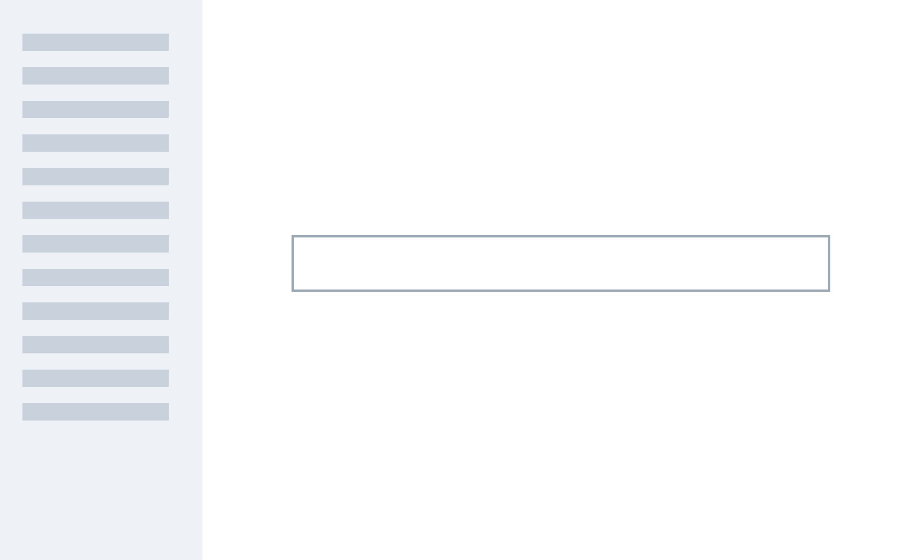

<!--
Neutral stand-ins for the statement combinations real talks use (0.44 hotfix): a statement whose body is a quote with
key words in bold and an attribution line; several quotes under {focus} with the title hidden; one quote under {focus};
a statement whose body is only a picture (a long sentence as its title, and a one-word title over a screenshot); a
plain statement with bold key words. Walked by test-ocean-look-dom.mjs in the default look, in Bold and in classic.
-->

# Statement combinations

## Quotes and pictures

### Spring
{statement}{id=sc-quote}

> By the end of the season, the **least interesting task** the new tools will do is **answer single questions**, yet that is how most people will still picture them. Expect **some confusion** as a result.

— A. Writer, A Monthly Letter, **March** 2026, Newsletter

### Autumn
{statement}{focus}{id=sc-focus-quotes}

> **Two seasons ago**, the planning tools did not exist. The older models were the best on offer.

> **One season ago**, the strongest public model was a preview, and most of those who used it (i.e., most of a small share of customers) treated it as a search box.

> **Now** (i.e., **while I write** this), I have an assistant **building** several pieces of **custom software** and running a **long data-cleaning job** for me. The job has been **running unattended** for nearly four days. I have several **working apps on my phone** that I use daily and which were **built entirely by the assistant**.

- B. Author, Social post, **October** 2026

### Who wrote this?
{focus}{statement}{id=sc-focus-one}

> Assistants have crossed a line I did not expect so soon. Not just impressive demos - but practical tools for daily use.

### We stopped using the old chat window months ago and not at all last week
{statement}{id=sc-picture-sentence}

### Toolkit
{statement}{id=sc-picture-word}

### Plain
{statement}{id=sc-plain}

An assistant is a model that keeps going until the **job is done**.
