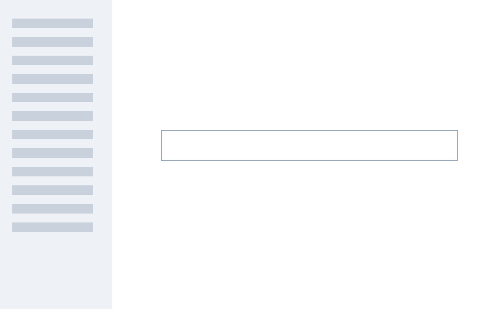

<!--
Neutral stand-ins for the trigger combinations real talks use, found by scripts/audit-talks-look.mjs (0.44 round 2):
icon lists in their list form beside the title rail and with {focus}; statements holding a list; icon rows with
detail lines. Walked by test-ocean-look-dom.mjs in the default look, in Bold and in classic.
-->

# Talk combinations

## Lists beside the rail

### Raise a hand if you
{iconlist}{focus}{id=tc-iconlist-focus-3}

- Have used a chat assistant
- Have used a coding assistant
- Have an assistant running at home

### Five habits
{iconlist}{focus}{id=tc-iconlist-focus-5}

- Read the brief {icon=lucide:book-open}
- Plan the steps {icon=lucide:list-checks}
- Call the tools {icon=lucide:wrench}
- Check the result {icon=lucide:search-check}
- Report back {icon=lucide:message-square}

### What it needs
{iconlist}{id=tc-iconlist-details}

- A model {icon=lucide:brain}
  - reads and writes text
- A harness {icon=lucide:cpu}
  - runs the loop and keeps the history of every step it took
- Tools {icon=lucide:wrench}
  - search, files and code

### Many small parts
{iconlist}{reveal}{id=tc-iconlist-eight}

- Model {icon=lucide:brain}
- Harness {icon=lucide:cpu}
- Tools {icon=lucide:wrench}
- Memory {icon=lucide:database}
- Planner {icon=lucide:map}
- Checker {icon=lucide:search-check}
- Sandbox {icon=lucide:box}
- Logs {icon=lucide:scroll-text}

### A statement with a list
{statement}{id=tc-statement-list}

The assistant does three things:

- reads the task
- calls the tools
- reports back

## Plain lists

### Why keep notes
{id=tc-plain-3}

- Chats are forgotten, files are kept
- Other assistants can read the files
- Colleagues can open them too

### Workshop outputs
{id=tc-plain-5}

- Trackers
- Timelines
- A reading tracker with notes on every paper read so far this term
- Dashboards
- Fieldwork or admin timeline

### Everything an assistant touched this week
{id=tc-plain-9}

- Inbox
- Calendar
- Shared drive
- Notes
- Spreadsheets
- Slides
- Code
- Forms
- Reports

### Points with details
{focus}{id=tc-plain-details}

- Model choice
  - the strongest model for planning, a cheaper one for routine steps
- Reasoning effort
  - more effort costs time
- Tools
  - files, search and a terminal

## Combinations from the audit

### Three bands
{iconlist}{focus}{id=tc-bands}

- Chat assistant {icon=lucide:message-square}
- Coding assistant {icon=lucide:code}
- Assistant at home {icon=lucide:house}

### What the day is
{iconlist}{id=tc-bands-long}

- **Today is** seeing, by doing, what assistants can do with your own files, safely and repeatably {icon=lucide:eye}
- **Today is not** a full training in any one tool, nor a programming course for beginners {icon=lucide:ban}
- **Learning in depth comes afterwards:** the workbook and the recordings stay open for a month {icon=lucide:book-open}

### Four roles
{iconrow}{focus}{titlelook=kicker}{id=tc-iconrow-focus-4}

- Reader {icon=lucide:book-open}
- Writer {icon=lucide:pen}
- Checker {icon=lucide:search-check}
- Runner {icon=lucide:play}

### Three roles beside the rail
{iconrow}{sidebar}{id=tc-iconrow-rail}

- **Research tool** {icon=lucide:search}
  - finds and reads sources
- **Phenomenal writer** {icon=lucide:pen}
  - drafts and redrafts
- **Patient tutor** {icon=lucide:graduation-cap}
  - explains again

### Prompt
{sidebar}{bg=emerald}{id=tc-named-ground}

> Summarise the three reports in one page and list what they disagree on.

— My prompt

### Periods
{annotated}{numbered}{id=tc-annotated-numbered}

- **Learning** from examples
  - the first systems
- **Communicating**, perceiving
  - language and vision
- **Acting** in the world
  - tools and agents

### What you need
{id=tc-cards-nested}

- Model {icon=lucide:brain}
  - Source of the answers
    - User prompts
    - Model responds
- Harness {icon=lucide:cpu}
  - Runs the loop
    - Calls the tools
- Tools {icon=lucide:wrench}
  - Touch the world
    - Files and search

### In numbers
{stats}{notitle}{id=tc-stats-caption}

- 3 million: weekly readers
  - and more people play each week
- 40: countries

### A **bold** title on a field
{statement}{id=tc-lead-marks}

Some words are ~~struck through~~ and some are **marked**.

## Review cases **marked** [with a link](https://example.com)

### Read on
{statement}{id=tc-statement-action}

A sentence that leads somewhere.

[Action: Read more -> https://example.com]

### Parts with links
{annotated}{id=tc-annotated-links}

- **Model** [docs](https://example.com)
  - reads and writes
- **Harness** [docs](https://example.com)
  - runs the loop

### Quote and picture
{statement}{id=tc-quote-picture}

> A short **quotation**.

### A painted title with a paragraph and a picture
{statement}{id=tc-title-para-picture}

A paragraph that says what the picture shows.

### A painted title with three paragraphs and a picture
{statement}{id=tc-title-paras-picture}

The first paragraph says what the screen is for.

The second paragraph says where to click first.

The third paragraph says what happens next.

### A **bold** [link](https://example.com) `code` ==highlight== title
{iconrow}{id=tc-tab-marks}

- Reader {icon=lucide:book-open}
- Writer {icon=lucide:pen}
- Checker {icon=lucide:search-check}

### A **bold** title on a named ground
{statement}{bg=emerald}{id=tc-tab-marks-ground}

Words on the ground the author named.

### Two kinds of assistant
{iconrow}{id=tc-panel-lines-2x4}

- Chat assistant {icon=lucide:message-square}
  - answers questions in a window
  - drafts and redrafts text
  - reads the files you attach
  - forgets between sessions
- Coding assistant {icon=lucide:code}
  - works inside a project folder
  - runs commands and tests
  - edits many files at once
  - keeps notes for next time

### Three places to work
{iconrow}{id=tc-panel-lines-3x3}

- Browser {icon=lucide:globe}
  - nothing to install
  - works on any machine
  - files stay in the cloud
- Desktop {icon=lucide:monitor}
  - reads local folders
  - works offline for some tasks
  - one machine at a time
- Terminal {icon=lucide:terminal}
  - full control of the tools
  - scripts and automation
  - the steepest start

## Long content

### Five years of papers
{timeline}{id=tc-long-timeline}

- 2013 - Word vectors - A. Author, B. Author, C. Author and D. Author, a paper on learning representations of words from very large text collections
- 2014 - Sequence models - E. Author, F. Author and G. Author, a paper on mapping one sequence of words onto another with neural networks
- 2015 - Attention - H. Author, I. Author and J. Author, a paper on letting a model look back at the parts of the input that matter
- 2016 - Larger models - K. Author and L. Author, a report on what happens when the same model is trained on far more text
- 2017 - Transformers - M. Author, N. Author, O. Author and P. Author, a paper on models built from attention alone
- 2018 - Pre-training - Q. Author and R. Author, a paper on training once on general text and then adapting to many tasks

### Dates to keep in mind
{id=tc-long-items}

- 10 December: the last date for you to move your saved assistants to the new workspace, after which the old workspace becomes read-only for everyone in the department
- 11 December: the old custom assistants are scheduled to stop answering, so any that you still rely on should be rebuilt in the new workspace before then
- 12 December: the training sessions move to the new building, with the same times and the same booking system as before the move
- 13 December: the help desk closes for the winter break and reopens in the first week of January with longer opening hours

### The loop in long words
{cycle}{font-body=xl}{id=tc-long-cycle}

- Harness: sends instructions and the latest results to the model
- Model: makes a plan for the next step of the work
- Model: sends a command back to the harness to run
- Harness: passes the command to the computer and waits
- Computer: executes the command and returns the output to the harness

### The landscape of large models today: what the assistants run on, how to compare them and how to choose a better one for your work
{statement}{id=tc-long-title}

Assistants run on models, and the model matters more than the app.

## End

### Last word
{id=tc-end}

- One plain point to end the walk
