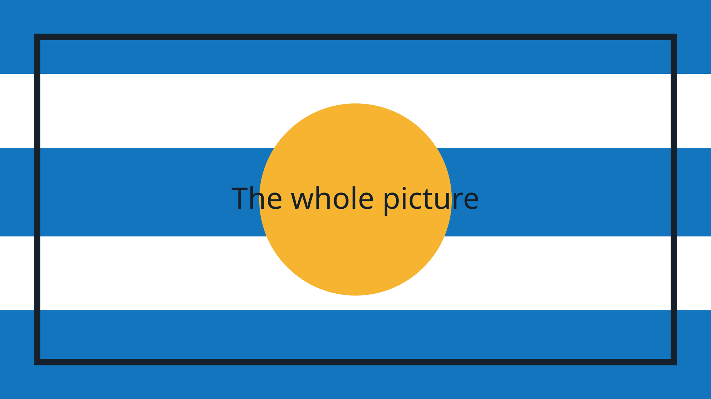

# Title and picture

### A clear title above the picture
{image-claim}{id=default}

### A title on a solid band
{media}{media-title=overlay}{id=overlay}

### No painted title
{media}{notitle}{id=untitled}

### Two whole figures
{media}{id=row}

### An embedded page
{media}{id=embed}

[Embed: embed.html]

### The handout
{statement}{id=qr}

The full address is available when the code is enlarged.

[QR: https://researchsnacks.semanticmachines.fyi/2026/11/17/a-long-synthetic-path-for-a-fixture?view=full#details]

### A figure in copy-visual
{copy-visual}{id=copy-visual}

### A figure in list-visual
{list-visual}{id=list-visual}

### A figure in timeline-visual
{timeline-visual}{id=timeline-visual}

### A figure in columns
{columns}{id=columns}

### A figure in smartart
{smartart}{id=smartart}

## Section blue
{section-colour=blue}{id=section-blue}

### A clear title in blue
{image-claim}{id=colour-blue}

### A band in blue
{media}{media-title=overlay}{id=band-blue}

## Section amber
{section-colour=amber}{id=section-amber}

### A clear title in amber
{image-claim}{id=colour-amber}

### A band in amber
{media}{media-title=overlay}{id=band-amber}

## Section deep-blue
{section-colour=deep-blue}{id=section-deep-blue}

### A clear title in deep-blue
{image-claim}{id=colour-deep-blue}

### A band in deep-blue
{media}{media-title=overlay}{id=band-deep-blue}

## Section light
{section-colour=light}{id=section-light}

### A clear title in light
{image-claim}{id=colour-light}

### A band in light
{media}{media-title=overlay}{id=band-light}

## Section light-amber
{section-colour=light-amber}{id=section-light-amber}

### A clear title in light-amber
{image-claim}{id=colour-light-amber}

### A band in light-amber
{media}{media-title=overlay}{id=band-light-amber}

### Pictures in a carousel
{carousel}{id=carousel}

#### The first whole picture
{media}

#### Another whole picture
{media}

### A picture with two claims
{image-claim}{id=picture-with-claims}

- Keep the entrance clear for the next group.
- Share the route before the walk begins.

### A picture beside a quotation
{image-quote}{title=top}{id=picture-with-quote}

> A clear route helps everyone stay together.

- The walking group

### An untitled child picture fills its frame
{carousel}{id=tiny-carousel}

#### A tiny source uses the whole child frame
{media}{notitle}

#### A readable band in a child
{media}{media-title=overlay}

### A **clear** *marked* ==title==
{media}{media-title=overlay}{id=inline-band}

